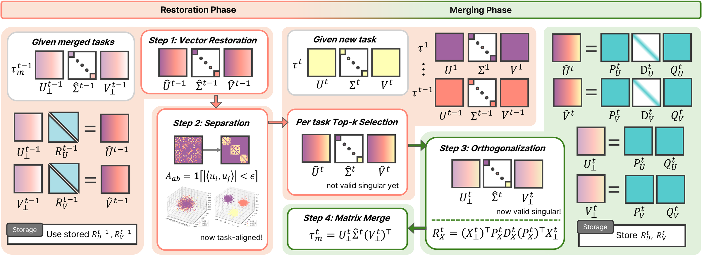

# [NeurIPS 2026] Robust and Efficient Continual Model Merging via Global Singular Subspace Separation and Restoration
[](https://arxiv.org/abs/2611.10881) [](https://openreview.net/forum?id=wdIBHsopRB)  
This repository is the official implementation of our paper __Robust and Efficient Continual Model Merging via Global Singular Subspace Separation and Restoration__




## Installation
We use docker for experiments

```bash
# Mount your local copy of this repository. Adjust the paths to your environment
docker run -itd --gpus all --name GS3R --ipc=host -v /path/to/GS3R:/workspace/GS3R pytorch/pytorch:2.7.1-cuda11.8-cudnn9-devel
```

```bash
cd /workspace/GS3R
pip install -e . # install the package in editable mode => fusion bench
pip install -r req.txt # install packages
```

## Experiments

Use commands in `exp_script` folder
```bash
./exp_script/GS3R/exp_cont.sh # ViT-B/32 / 8 Tasks experiment
./exp_script/GS3R_Trunc/exp_cont_trunc.sh # ViT-B/32 / 8 Tasks / truncated (r=256)  experiment
./exp_script/GS3R_Opt/exp_cont_opt.sh # ViT-B/32 / 8 Tasks / +Optimization experiment
```
Output files will be placed in `outputs` folder

## Acknowledgements

This codebase is built on [FusionBench](https://github.com/tanganke/fusion_bench) (MIT License) and
the [OPCM](https://github.com/tanganke/opcm) repository, from which the continual merging setup and
experiment scripts are adapted. The GS3R merging routines started from FusionBench's implementation of
[Task Singular Vectors](https://github.com/AntoAndGar/task_singular_vectors) (Gargiulo et al., CVPR 2025,
Apache-2.0), and the optional auxiliary optimization minimizes the objective of
[WUDI-Merging](https://github.com/nathanielyvo/WUDI-Merging) (Cheng et al., ICML 2025, MIT License).

## License

This project is released under the MIT License (see `LICENSE`).
